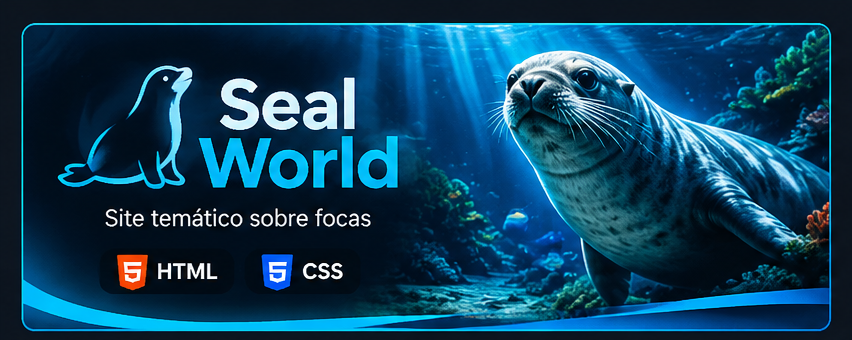

# 🦭 Seal World

### Projeto de desenvolvimento web com temática sobre focas

## 📌 Sobre o projeto

O Seal World é um projeto desenvolvido durante meus estudos de desenvolvimento web, com o objetivo de praticar a construção e a estilização de páginas utilizando HTML e CSS.

O site apresenta conteúdo temático sobre focas, combinando elementos visuais, imagens, vídeo e organização de conteúdo em uma página web.

## 🌐 Acesse o projeto

🔗 **[Visualizar Seal World](https://davidalvesjr.github.io/seal-world/)**

## 🛠️ Tecnologias utilizadas

- HTML
- CSS

## 📂 Estrutura do projeto

- `index.html` — Estrutura principal da página.
- `style.css` — Estilização e apresentação visual.
- `img/` — Imagens utilizadas no projeto.
- `video/` — Vídeo utilizado na página.

## 🎯 Objetivo de aprendizagem

Praticar os fundamentos do desenvolvimento web, trabalhando a estruturação de conteúdo com HTML e a estilização de elementos com CSS.

## 👨‍💻 Autor

**David Alves**

Estudante de Análise e Desenvolvimento de Sistemas e desenvolvedor Full Stack em formação.

- [GitHub](https://github.com/davidalvesjr)

---

⭐ Projeto desenvolvido para fins de aprendizado e evolução na área de desenvolvimento web.
